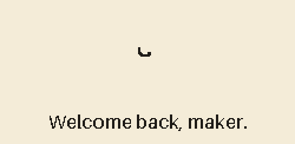

# Spiral Node
**Spiral Node: a pocket e-ink device that hands you ideas and leaves the thinking to you. Offline. Open source.**

[Try it in your browser →](https://spiral-node.vercel.app/try)

## What it is

* **Fully offline**: no internet, no account, nothing leaves the device.
* **E-ink**: a 2.13 inch, 250x122 black-and-white screen.
* **Scripts**: small Python loops that show something to think about every 15, 30 or 60 seconds. Built in: Fun Fact + Question, Quick Story, and Connect (two random topics: what links them?).
* **No repeats**: every entry shown is logged; when a library runs out, you choose to start over.
* **Spiral wheel**: one wheel for up, down, left, right and press.
* **Prototype in progress**: the hardware is being tested. Battery life isn't measured yet.
* **Sourced facts**: every fact links to where it came from.

## Star history

[](https://star-history.com/#trooper7652-commits/spiral-node&Date)

## Quick start
### OS
```
cd os
python -m venv .venv && . .venv/bin/activate
pip install "Pillow>=10.1" pytest
python -m pytest -q
python -m spiral --snapshot out.png
```

### Website
```
cd website
npm install
npm run dev        # http://localhost:3000, the simulator is at /try
npm test
```

## Star the repo and write a script

If Spiral Node sparks something for you, a star helps other people find it. Better still, write a script: copy `scripts/TEMPLATE`, follow [CONTRIBUTING.md](CONTRIBUTING.md), and see your pages on the real Spiral OS in the simulator. Pick up a [good first issue](https://github.com/trooper7652-commits/spiral-node/issues?q=is%3Aissue+is%3Aopen+label%3A%22good+first+issue%22) or say hello in [Discussions](https://github.com/trooper7652-commits/spiral-node/discussions).

## Folders
| Folder | Description |
| :--- | :--- |
| `os/` | Spiral OS, in Python |
| `website/` | The website and the browser simulator |
| `scripts/` | Community scripts, and `TEMPLATE` to start yours |
| `hardware/` | Prototype parts and form factor |
| `docs/` | Images for this README |
| `LICENSES/` | Licence texts and which folder uses which |

## Licences

Code is GPL-3.0 ([LICENSE](LICENSE)). Hardware notes are CERN-OHL-S-2.0. Docs, art and script content are CC BY-SA 4.0. See [LICENSES/README.md](LICENSES/README.md).

Made by Helix Velocities.
